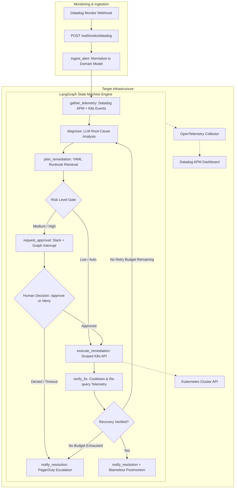

# Autonomous SRE Incident Copilot

> **An Agentic AI Engine for Autonomous Incident Triage, Root Cause Analysis, and Guardrailed Remediation on Kubernetes.**

[](https://www.python.org/)
[](https://github.com/langchain-ai/langgraph)
[](https://kubernetes.io/)
[](https://opentelemetry.io/)
[](LICENSE)

---

## Overview

Modern cloud microservices—especially real-time streaming engines, speech pipelines, and high-concurrency APIs—suffer from unpredictable incidents: memory leaks, traffic saturation, and transient crash loops. When an alert fires at 3:00 AM, human triage takes 20–45 minutes, breaching critical SLAs.

**Autonomous SRE Incident Copilot** is a production-grade agentic system built with **LangGraph**, **FastAPI**, **Datadog**, and **Kubernetes**. It ingests telemetry alerts, pulls correlated metrics/logs/traces, synthesizes root-cause hypotheses with confidence scoring, matches version-controlled runbooks, and safely executes bounded remediation actions against Kubernetes clusters.

### Key Highlights
* **Deterministic Guardrails:** The LLM does *not* execute arbitrary shell commands. It selects strictly typed actions (`restart_deployment`, `scale_deployment`, `rollback_deployment`) defined in version-controlled YAML runbooks.
* **Human-in-the-Loop (HITL) Approval Gate:** Low-risk self-healing executes automatically. Higher-risk actions (rollbacks, capacity scaling) halt the graph using LangGraph checkpoints (`interrupt_after`) and require interactive Slack approval.
* **Closed-Loop Verification:** The agent never assumes success—it re-samples telemetry post-remediation. If unresolved, it loops back with bounded retry budgets before escalating to PagerDuty.
* **Two-Way Observability (OTel):** The agent instruments its own internal reasoning steps using OpenTelemetry spans exported back to Datadog APM.

---

## Architecture



---

## Safety & Security Model

| Layer | Implementation | Protection |
| :--- | :--- | :--- |
| **RBAC Least Privilege** | [`k8s/rbac.yaml`](k8s/rbac.yaml) | Namespace-scoped ServiceAccount. Zero access to Secrets. No `delete` verbs. |
| **Action Typing** | Pydantic Schema Enum | Constrains LLM to `restart_deployment`, `scale_deployment`, `rollback_deployment`. |
| **Approval Ceiling** | `AUTO_REMEDIATE_MAX_RISK` | Actions exceeding threshold freeze state until human Slack confirmation. |
| **Circuit Breaker** | `MAX_DIAGNOSIS_RETRIES = 2` | Prevents infinite remediation loops; escalates to human on-call via PagerDuty. |

---

## Project Structure

```
├── src/agentic_sre/
│   ├── agent/                 # LangGraph state machine (state.py, nodes.py, graph.py, prompts.py)
│   ├── runbooks/              # Version-controlled YAML runbooks & matching engine
│   ├── tools/                 # Integration clients (Kubernetes, Datadog API, Slack, PagerDuty)
│   ├── otel/                  # OpenTelemetry tracing & node instrumentation decorators
│   ├── config.py              # Environment settings & risk threshold checks
│   ├── models.py              # Pydantic domain models (Alert, Incident, Diagnosis, Remediation)
│   └── main.py                # FastAPI webhook receiver & HITL approval REST API
├── docker/                    # Dockerfile, docker-compose, and OTel collector configs
├── k8s/                       # Kubernetes deployment, RBAC Role/Binding, and Service
├── tests/                     # Pytest suite with mocked telemetry & routing tests
├── run_demo_standalone.py     # Zero-dependency interactive pipeline simulation
├── simulate_incident.py       # Full state machine simulation runner
├── requirements.txt
└── .env.example
```

---

## Quickstart

### 1. Instant Interactive Demo (Zero Installs Required)
Run the self-contained demonstration using only Python's standard library:
```bash
python run_demo_standalone.py
```

### 2. Full Local Environment Setup
```bash
# 1. Create and activate virtual environment
python -m venv .venv
source .venv/bin/activate  # On Windows: .\.venv\Scripts\Activate.ps1

# 2. Install dependencies
pip install -r requirements.txt

# 3. Configure environment
cp .env.example .env

# 4. Run automated test suite
pytest tests/

# 5. Launch FastAPI server
uvicorn agentic_sre.main:app --reload --port 8080
```

---

## License

This project is licensed under the [MIT License](LICENSE).
